# Zambodi Search


Zambodi Search is a Chrome extension that rebrands Google as Zambodi, a search
engine that exists in exactly one browser: yours. Every "Google" on every page
becomes "Zambodi", google.com wears a bevelled 2000s-style Zambodi wordmark, the
tab says Zambodi, the new tab page looks like a search homepage from 2004, and
the address bar offers to "Search Zambodi". The searching itself is still done
by Google; Zambodi just takes the credit. It is a parody with no affiliation to
Google, makes no network calls of its own and has one switch to turn it off.


The same demo as video: [docs/demo.mp4](docs/demo.mp4).

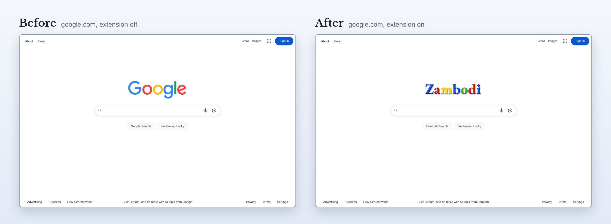

## Install

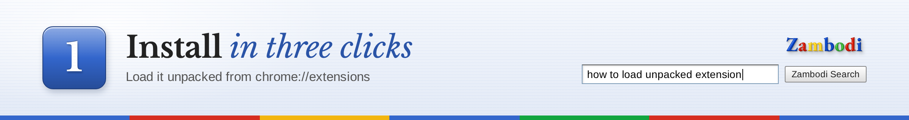

Zambodi Search is not on the Chrome Web Store. Load it unpacked:

1. Download `zambodi-search-<version>.zip` from the
   [latest release](../../releases/latest) and unzip it (or clone this
   repository; the folder with `manifest.json` in it is the extension).
2. Open `chrome://extensions` and switch on **Developer mode** (top right).
3. Click **Load unpacked** and pick the unzipped `zambodi-search` folder.

Chrome then shows up to three things worth knowing about:

- **"Read and change all your data on all websites".** Chrome lists this in
  the extension's details because the text replacement runs on every site.
  [How it works](#how-it-works) explains what it does with that access.
- **"Keep it" or "Change it back".** The first new tab you open shows a
  bubble saying an extension changed what page is shown when you open a new
  tab. Click **Keep it** to keep the Zambodi homepage.
- **The search engine prompt (Windows and macOS).** The extension registers
  "Zambodi" as your default search engine, and Chrome asks whether to keep
  the change or change it back; keep it if you want the address bar to say
  "Search Zambodi". Searches still go to google.com, where the extension
  rebrands the results.

To remove it, click **Remove** on its card in `chrome://extensions`.

## What it changes

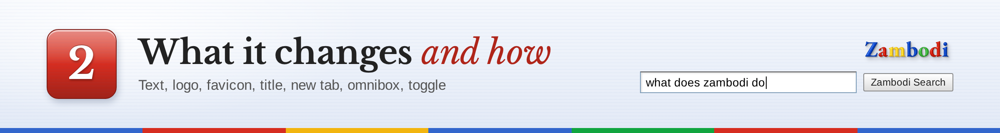

- **Text, everywhere.** Every visible "Google" on any site becomes "Zambodi",
  keeping the case it was written in: Google, google and GOOGLE become
  Zambodi, zambodi and ZAMBODI, and Google's becomes Zambodi's. Text that
  arrives later (infinite scroll, single-page apps, Gmail) is caught too, as
  are button labels, placeholders, tooltips, `aria-label` and `alt` text,
  text inside iframes and inside open shadow roots, and "Google" next to
  Japanese, Chinese, Korean or Thai text. It never touches scripts, styles,
  text you are typing, or editable regions, and a dropdown option that reads
  "Zambodi" still submits the value the site expects.
- **google.com logo.** The homepage logo and the small logo on results pages
  are replaced with the Zambodi wordmark, with no flash of the original. On
  doodle days the doodle is hidden and the wordmark takes its place. The
  logo still links home. This runs on every Google search country domain
  (the 187 on Google's own supported-domains list), on the `www` and bare
  hosts.
- **Favicon and tab title.** On Google pages the favicon is the Zambodi "Z"
  and the tab title says Zambodi, updated as you search.
- **New tab page.** A 2000s-style Zambodi homepage: the wordmark, a search
  box, "Zambodi Search" and "I'm Feeling Lucky" buttons, a tabs row and the
  classic footer. Searches go to google.com.
- **Omnibox.** "Zambodi" is registered as a search engine with the keyword
  `zambodi` (Windows and macOS; see [Limitations](#limitations)).
- **Popup toggle.** Click the toolbar icon for a small popup with one on/off
  switch. Off means pages you load from then on are left alone; pages already
  open keep their state until reloaded.

## Screenshots

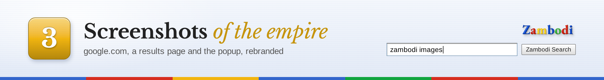

The google.com homepage, rebranded:

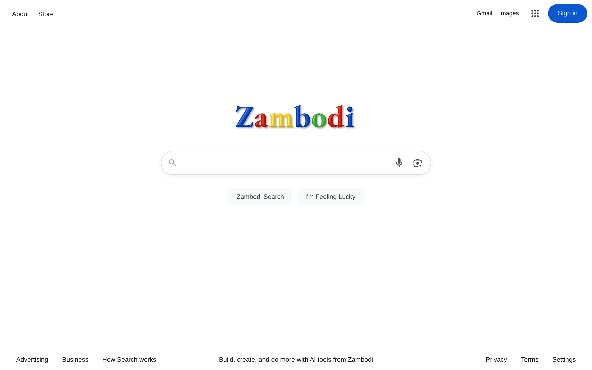

A results page for "zambodi search". Google's bot check blocks automated
browsers on search results, so this is a mock results page bundled with the
repository (`docs/src/google-results-mock.html`, every result fictional),
rendered through the extension's real content scripts. Setting
`ZAMBODI_RESULTS_HTML` replays a real saved results page instead (see
[Regenerate the images](#regenerate-the-images)):

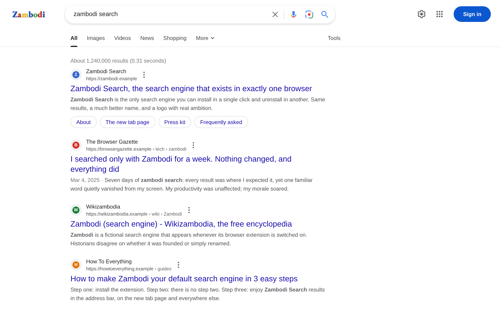

The toolbar popup:

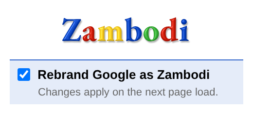

## The new tab page

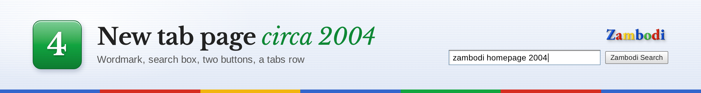

Every new tab opens on Zambodi's own homepage, styled after the search
homepages of the mid 2000s. Type a query and press Enter or click
**Zambodi Search** to search google.com, which then shows up rebranded.

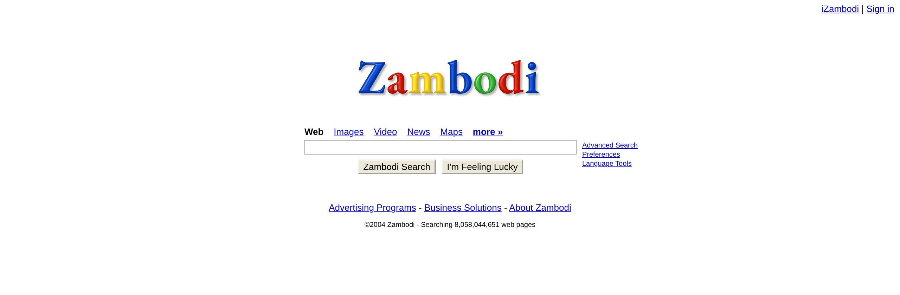

## How it works

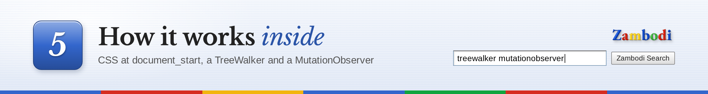

The extension is plain HTML, CSS and JavaScript that Chrome loads as is; there
is no build step.

- **No flash of the original logo.** A stylesheet injected at
  `document_start`, before Google's page has drawn anything, hides the known
  logo elements. The content script then inserts the Zambodi wordmark as soon
  as those elements exist. Nothing waits for the page's `load` event.
- **Text replacement.** A `TreeWalker` visits the page's text nodes once, and
  a `MutationObserver` handles everything added or changed afterwards. Both
  share one pure replacement function in `src/lib/` that preserves case and
  possessives and is covered by unit tests.
- **Stable selectors.** Google's class names are generated and change often,
  so the extension finds the logo, buttons and labels by attributes such as
  `alt`, `aria-label`, `title` and `role`.
- **One stored value.** The popup writes a single `enabled` flag to
  `chrome.storage.local`. Content scripts read it once when a page starts
  loading, so a change applies from the next page load.
- **Runs on every site, calls nowhere.** The text replacement is a content
  script matched to every page, and that match is the site access Chrome
  quotes as "Read and change all your data on all websites". The manifest's
  `permissions` list holds only `storage`, for the on/off flag. The
  extension makes no network calls of its own and loads no remote code: the
  wordmark is SVG paths generated at build time from an open-licensed font,
  so no font is fetched at runtime, and every image ships inside the
  extension.

## Regenerate the images

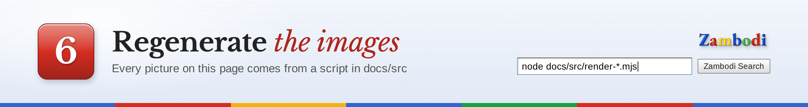

Every image in this README, and the demo video, is produced by a script in
`docs/src/`, which has its own `package.json` pinning `playwright-core`. Run
these from the repository root:

```bash
npm --prefix docs/src install                             # once
npx --prefix docs/src playwright-core install chromium    # once, if no Chromium is cached

node docs/src/render-title-card.mjs     # docs/images/readme-title-zambodi.png
node docs/src/render-headers.mjs        # docs/images/header-*.png
node docs/src/render-screenshots.mjs    # google-home, google-results, newtab, popup, before-after
FFMPEG_PATH=/path/to/ffmpeg node docs/src/record-demo.mjs   # docs/images/demo.gif and docs/demo.mp4
```

- `render-screenshots.mjs` takes image names to render only some, for example
  `node docs/src/render-screenshots.mjs newtab popup`. It loads the unpacked
  extension into a throwaway profile under `docs/src/profile/`. If Google
  answers with its "unusual traffic" page, that image is skipped with a
  message and the script exits with status 3; try again later.
- `record-demo.mjs` needs an ffmpeg with libx264, the GIF encoder and the
  palette filters. Set `FFMPEG_PATH`, or put `ffmpeg` on your `PATH`. The
  ffmpeg that Playwright downloads only encodes VP8 and is not enough; the
  script says so before recording anything.
- Results pages never come from Google, whose bot check blocks automated
  browsers: `render-screenshots.mjs` and `record-demo.mjs` answer navigations
  to `https://www.google.com/search` with the bundled mock
  `docs/src/google-results-mock.html`, and the extension rebrands it with its
  real content scripts. `ZAMBODI_RESULTS_HTML` names a results page saved
  from Chrome (Ctrl+S, "Webpage, HTML Only"), for example
  `docs/src/out/google-results.html`, which is gitignored, to replay instead.
- `CHROMIUM_PATH` points any of the scripts at a different Chromium binary.
- The title card and headers need the Libre Baskerville and Arimo web fonts;
  if they fail to load, nothing is written.

Check the repository (lint, unit tests, manifest, image references,
public-safety scan) and build the release zip:

```bash
npm install
scripts/check.sh
scripts/package.sh        # dist/zambodi-search-<version>.zip
```

## Limitations

- **Google changes its markup.** The extension targets stable attributes, but
  if Google restructures its pages the logo or favicon swap can stop working
  until the selectors are updated. Text replacement keeps working regardless.
- **Other Google products keep their logos.** Gmail, Maps, YouTube and the
  rest still show their own logos; only their text says Zambodi.
- **The omnibox entry wears Google's favicon.** Chrome only accepts an
  `http(s)` icon URL for a search engine an extension registers, so the
  "Zambodi" engine in the address bar dropdown keeps the Google "G".
- **Closed shadow roots are out of reach.** Text inside an open shadow root
  is rewritten; a component that closes its shadow root keeps "Google".
- **The omnibox search engine is Windows and macOS only.** Chrome's
  [`chrome_settings_overrides`](https://developer.chrome.com/docs/extensions/reference/manifest/chrome-settings-override)
  documentation says the API "is available on Windows and Mac". On Linux and
  ChromeOS everything else works; to get the keyword there, add a site search
  by hand in `chrome://settings/searchEngines` with the name `Zambodi`, the
  shortcut `zambodi` and the URL `https://www.google.com/search?q=%s`.
- **Web addresses in page text change too.** Punctuation counts as a word
  boundary, so a visible "google.com" reads "zambodi.com". The links behind
  the text are untouched and still go where they went.
- **Pages that read back their own text can notice.** A page script that
  compares an element's text with "Google" now finds "Zambodi", and a React
  page rendered on the server may log a hydration mismatch and re-render;
  the replacement then applies again to the new text.
- **Chrome only.** No Firefox, Safari or Edge packaging, and no Web Store
  listing.

## Credits

- Wordmark font: [EB Garamond ExtraBold](https://github.com/octaviopardo/EBGaramond12)
  by Georg Duffner and Octavio Pardo, under the SIL Open Font License 1.1. The
  letters are converted to SVG paths at build time (`tools/logo/`), so the font
  itself is not part of the extension.
- README title card and headers use [Libre Baskerville](https://fonts.google.com/specimen/Libre+Baskerville)
  and [Arimo](https://fonts.google.com/specimen/Arimo), both under the SIL Open
  Font License 1.1, loaded from Google Fonts at render time only.

Zambodi Search is a parody. It is not affiliated with, endorsed by or
connected to Google LLC. "Google" is a trademark of Google LLC.

## License

[MIT](LICENSE)
